# Unchanged CPython on UNIVERSE

UNIVERSE runs the official [python-build-standalone](https://github.com/astral-sh/python-build-standalone)
CPython 3.13.16 build for x86-64 Linux/musl on an ARM64 Mac. The interpreter,
`libpython3.13.so`, its extension modules and Alpine's musl dynamic loader are
the unchanged upstream bytes; UNIVERSE executes their x86-64 code with its own
CPU engine and Linux system-call layer.

<p align="center"></p>

```sh
zig build -Doptimize=ReleaseSafe
python3 scripts/python.py            # pinned Alpine 3.22.6 minirootfs + CPython 3.13.16
./zig-out/bin/universe --unlimited --allow-files \
  --sysroot artifacts/python-x86_64/sysroot /opt/python/bin/python3 \
  -c 'import sys, sqlite3; print(sys.platform, sqlite3.connect(":memory:").execute("select 6*7").fetchone())'
# linux (42,)
```

For the interactive REPL, drop `-c ...` and add `--env TERM=xterm-256color`.

`scripts/python.py` verifies the SHA-256 of both upstream archives. With
`--sysroot`, an absolute binary path that exists inside the sysroot names the
guest file, and the guest sees `/opt/python/bin/python3` as its `argv[0]`, as a
chroot would. A host working directory outside the sysroot starts the guest at
its `/`, like `chroot(1)`; `--unlimited` removes the default 10-million
instruction and 10-second safety limits.

## Verified

`python3 tests/python.py` passes **10/10 checks** (five per engine, interpreter
and JIT): one exact-output workload covering `json`, `re`, `hashlib`, `zlib`,
`sqlite3`, four guest threads, `decimal`, dataclasses, big integers and Unicode
file round trips; `subprocess` runs of Alpine's BusyBox `echo`, a
`printf | sort | head` shell pipeline and a child exit status; plus exit-status
and traceback cases; and Python 3.13's colored interactive REPL on a real
pseudo-terminal, which evaluates `print(6 * 7)` and exits cleanly.

To use the REPL yourself, run the command above without `-c ...` from a
terminal. `scripts/python.py` links `/usr/share/terminfo` to Python's own
terminfo database so `TERM=xterm-256color` works; pass it with
`--env TERM=xterm-256color`, because the guest environment starts empty.

CPython drove three Linux ABI additions:

- `mremap` shrinks, grows in place or moves an owned private mapping
  (`MREMAP_MAYMOVE`), as musl's `realloc` does for large blocks.
  `MREMAP_FIXED` and shared-mapping duplication return `EINVAL`.
- `membarrier` reports and accepts the global and private-expedited commands.
  Guest threads run serially on one host thread, so these barriers already hold.
- `argv[0]` translation for binaries inside a sysroot, so `sys.executable` and
  the standard-library search find `/opt/python/lib/python3.13`.

`subprocess` drove three more:

- Absolute paths under `--sysroot` now resolve as under chroot: symlinks are
  walked by UNIVERSE, absolute targets restart at the sysroot and `..` stops
  there. Alpine's `/bin/echo -> /bin/busybox` therefore reaches the sysroot's
  BusyBox, not the host's `/bin`. The final component is followed only where
  Linux follows it (`lstat`, `readlink`, `unlink`, `rename`, `O_NOFOLLOW` and
  `AT_SYMLINK_NOFOLLOW` keep the link itself); loops return `ELOOP`. This is
  path translation, not confinement, and relative `dirfd` paths are still
  resolved by the host.
- `vfork` is a full `fork`, which POSIX permits because the child may only
  `exec` or `_exit`.
- `epoll_create`/`epoll_create1` return `ENOSYS`; Python's `selectors` then
  chooses `poll`, which UNIVERSE implements.

The REPL drove terminal support:

- `TCGETS`, `TCSETS`, `TCSETSW`, `TCSETSF` and `TIOCGWINSZ` on real host
  terminals. Linux termios flags and control characters are translated bit by
  bit through the host's own termios constants; files, pipes and devices still
  return `ENOTTY`, and speed always reads as B38400.
- `select`, `pselect6` and `ppoll` share `poll`'s readiness and deadline logic.
  `ppoll`/`pselect6` do not yet apply their temporary signal mask.

## Limits

- Speed: `python3 -c 'print(sum(i*i for i in range(100000)))'` retires about
  132 million guest instructions. On a shared Apple M2, the interpreter's
  median of three runs was 37.7 s with the 2026-10-12 starting build and 8.1 s
  on 2026-10-13, both measured back to back (roughly 16 million guest
  instructions per second). The gains come from a decoded-instruction cache,
  region lookup hints, single-region memory fast paths, by-reference CPU state
  and instructions, and batching scheduler checks to every 64 instructions
  between syscalls. Native CPython is still far faster. See
  [benchmarks](../benchmarks/results.md).
- `asyncio` needs a socket pair for its self-pipe and fails without networking.
- No networking: sockets return `EAFNOSUPPORT`.
- `--allow-files` grants host-user file access. UNIVERSE is not a sandbox.
